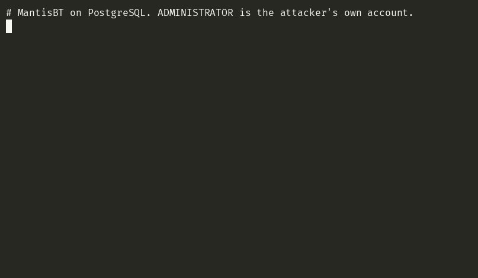

# MantisBT SOAP login as another user through a username case collision

Proof of concept for the incomplete fix of
[CVE-2026-47156](https://github.com/mantisbt/mantisbt/security/advisories/GHSA-c2xg-qjqw-2v98),
the MantisBT SOAP API authentication bypass. The first fix shipped in 2.28.4. On
PostgreSQL it can still be bypassed with an account whose name differs from the
target's only by case. The complete fix is in **MantisBT 2.29.0**, commit
[c494f763](https://github.com/mantisbt/mantisbt/commit/c494f763305a398e8bbda6903b34d8d1d94eb714),
and the follow-up is tracked in the same advisory.



## The bug

The SOAP API accepts a user's `cookie_string` in place of a password. The
2.28.4 fix checks that the cookie belongs to the user named in the request,
then logs in by that name:

```php
// api/soap/mc_api.php, mci_check_login(), 2.28.4
$t_user_id = auth_user_id_from_cookie( $p_password );
if( $t_user_id !== false ) {
    if( 0 != strcasecmp( user_get_username( $t_user_id ), $p_username ) ) {
        return false;
    }
    if( auth_attempt_script_login( $p_username ) === false ) {
        return false;
    }
}
```

`strcasecmp()` ignores case. The login looks the name up with
`WHERE username = ?`, which on PostgreSQL compares case-sensitively. MantisBT's
uniqueness check uses the same lookup, so `ADMINISTRATOR` can be registered
next to `administrator`. The owner of `ADMINISTRATOR` sends their own cookie
with the name `administrator`, passes the check, and gets a SOAP session as
`administrator`.

2.29.0 logs in with the name read from the cookie's own account instead of the
name in the request.

## Conditions

- PostgreSQL, or MySQL with a case-sensitive collation. MantisBT's default
  MySQL setup compares case-insensitively and is not affected.
- An account whose name is a case variant of the target. Self-registration is
  on by default and the default username rule allows upper case.
- The SOAP API, which 2.28.x always serves at `api/soap/mantisconnect.php`.

## Run it

Needs Docker with Compose and Python 3 with `requests`. The first start takes a
few minutes while the container installs PHP extensions and MantisBT.

```bash
./run.sh release-2.28.4   # vulnerable
./run.sh release-2.29.0   # fixed
```

`setup.sh` installs the chosen tag on PostgreSQL 16 with default settings, gives
`administrator` a random password, and creates `ADMINISTRATOR` through
`user_create()`, the function self-registration ends in, so the same uniqueness
check runs. A script cannot pass the signup CAPTCHA, which is the only reason
the account is not created through the signup page.

`exploit.py` then logs in to the web UI as `ADMINISTRATOR`, reads
`MANTIS_STRING_COOKIE`, and calls `mc_login` with the name `administrator` and
that cookie. Set `MANTIS_URL` to point it at another instance.

```
[1] Web login as ADMINISTRATOR, read MANTIS_STRING_COOKIE
    cookie = oFIFgG8toU2YX4Kj...
[2] SOAP mc_login(username='administrator', password=<ADMINISTRATOR cookie>)
    logged in as id=1 name=administrator access_level=90

[+] VULNERABLE: the ADMINISTRATOR cookie opened the administrator account
```

The lab listens on 127.0.0.1 only. Run it against systems you own.

## Fix

Upgrade to MantisBT 2.29.0.

## Disclosure

Reported privately to the MantisBT team in August 2026. The fix went into
master on 2026-09-04 and shipped in 2.29.0 on 2026-11-22, when the advisory was
updated to cover it.
